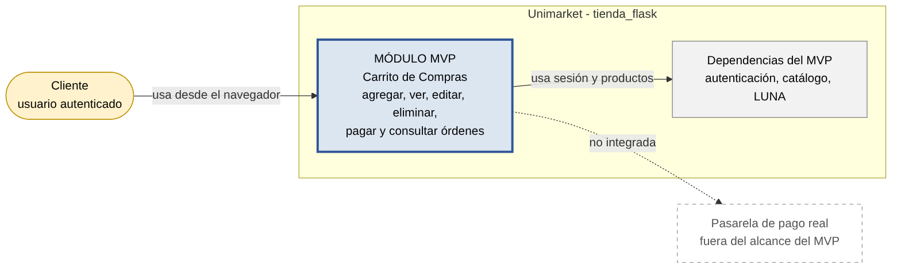
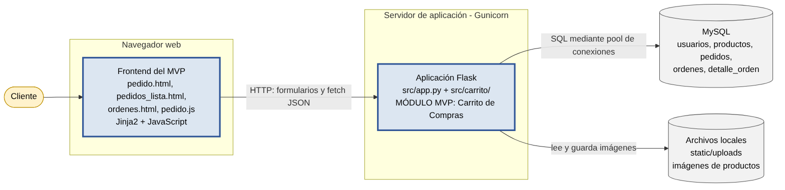
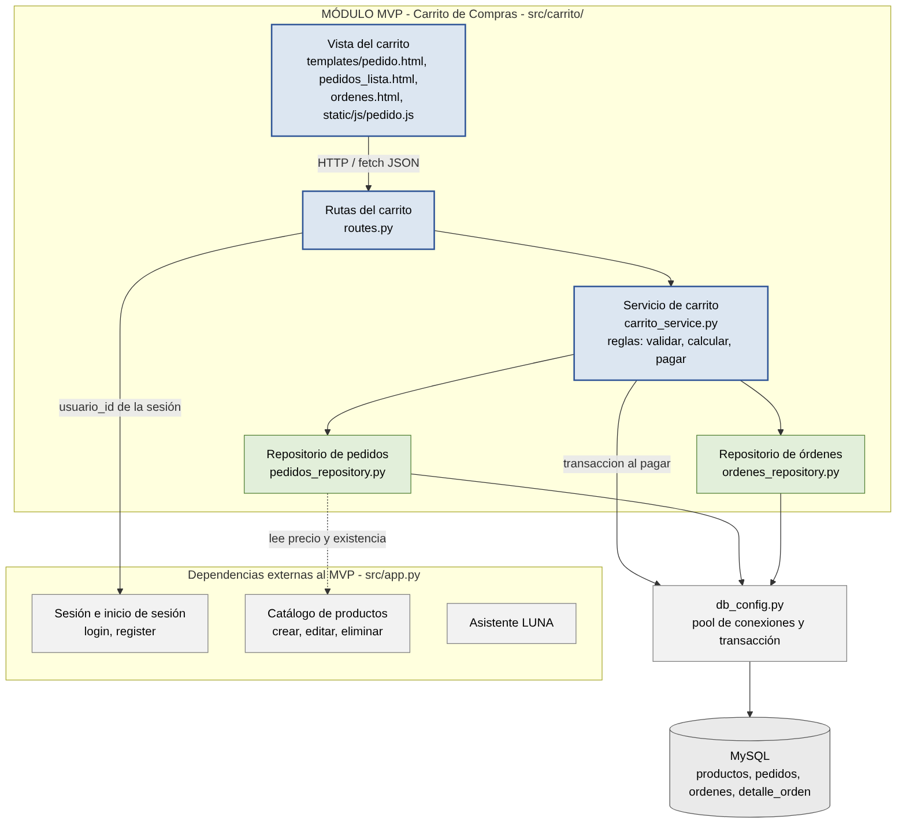
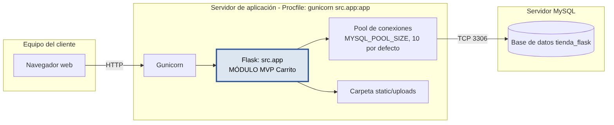

# Arquitectura objetivo — Módulo Carrito de Compras (Unimarket)

Versión 1 (semana 13). Los diagramas muestran cómo **queda** el sistema tras la
refactorización, no cómo estaba. El estado anterior está en el Entregable 1.

## 1. Diagramas C4 (versión 1)

Fuentes editables `.mmd` (Mermaid; se editan en <https://mermaid.live>) y versiones
exportadas `.png` / `.svg` en [`docs/diagramas/`](diagramas/).

| Nivel | Imagen | Fuente |
|-------|--------|--------|
| 1. Contexto |  | `01_contexto.mmd` |
| 2. Contenedores |  | `02_contenedores.mmd` |
| 3. Componentes del MVP |  | `03_componentes.mmd` |
| Despliegue |  | `04_despliegue.mmd` |

## 2. Componentes y responsabilidades

| Componente | Responsabilidad | Dependencias | Archivo actual |
|------------|-----------------|--------------|----------------|
| Vista del carrito | Mostrar catálogo, carrito, órdenes y mensajes; confirmar eliminar y pagar | Rutas del carrito | `templates/pedido.html`, `pedidos_lista.html`, `ordenes.html`, `static/js/pedido.js` |
| Rutas del carrito | Recibir las peticiones HTTP, tomar `usuario_id` de la sesión y responder (HTML con redirect o JSON) | Servicio, sesión | `src/carrito/routes.py` |
| Servicio de carrito | Reglas de negocio: validar cantidad y producto, calcular subtotales y total, detectar productos no disponibles, ejecutar el pago atómico | Repositorios, `transaccion()` | `src/carrito/carrito_service.py` |
| Repositorio de pedidos | SQL del carrito (siempre filtrado por usuario) y pasos del pago | `db_config` | `src/carrito/pedidos_repository.py` |
| Repositorio de órdenes | Guardar y consultar el historial de compras | `db_config` | `src/carrito/ordenes_repository.py` |
| Conexión a BD | Pool de conexiones, préstamo seguro (`conexion()`) y transacciones (`transaccion()`) | MySQL | `src/db_config.py` |
| Sesión y login *(externo al MVP)* | Autenticación; provee `usuario_id` | MySQL (`usuarios`) | `src/app.py` |
| Catálogo *(externo al MVP)* | Publicar, editar y eliminar productos | MySQL (`productos`) | `src/app.py` |
| LUNA *(externo al MVP)* | Asistente de recomendación | MySQL (`productos`) | `src/app.py` |

Regla de dependencias: Vista → Rutas → Servicio → Repositorios → `db_config` → MySQL.
Solo los repositorios escriben SQL; solo las rutas conocen Flask.

## 3. Decisiones de refactorización

Una por archivo en [`docs/adr/`](adr/).

| ADR | Decisión | Problema (E1) | Atributo que mejora |
|-----|----------|---------------|---------------------|
| [001](adr/001-pool-de-conexiones.md) | Pool de conexiones, préstamo seguro y transacciones | 3 | Eficiencia de ejecución |
| [002](adr/002-checkout-transaccional-con-ordenes.md) | Pago atómico con modelo de Orden y validación de disponibilidad | 4 | Idoneidad funcional |
| [003](adr/003-confirmaciones-y-mensajes.md) | Confirmaciones y mensajes claros en el carrito | 4 (sin comprobante) | Usabilidad |
| [004](adr/004-arquitectura-en-capas.md) | Separar rutas, servicio y repositorios | 1 | Soporta los tres (Mantenibilidad/Testabilidad) |
| [005](adr/005-control-de-acceso-por-usuario.md) | El carrito solo opera sobre pedidos del usuario en sesión | 2 | Idoneidad funcional (Seguridad en E1) |
| [006](adr/006-configuracion-y-esquema.md) | Esquema completo y clave secreta por variable de entorno | 5 | Idoneidad funcional (Seguridad/Mantenibilidad en E1) |

## 4. Escenarios de calidad (actualizados, semana 8)

Los de Usabilidad, Eficiencia e Idoneidad del Entregable 2, con el artefacto ajustado
a los archivos nuevos y el **estado real de verificación**.

### Usabilidad
| | |
|---|---|
| Estímulo | El cliente agrega, edita o elimina un producto, o confirma su compra, y necesita saber si la acción se realizó |
| Fuente | Usuario autenticado en la pantalla del carrito |
| Entorno | Uso normal de la tienda, desde computador o celular |
| Artefacto | `templates/pedido.html`, `pedidos_lista.html`, `ordenes.html` y `src/carrito/routes.py` |
| Respuesta esperada | Mensaje claro de éxito o error tras cada acción; confirmación antes de eliminar y antes de pagar |
| Medida | ≥ 90 % de usuarios completan agregar, editar, eliminar y pagar sin confusión; confirmación visual en < 1 s |
| Estado | **Implementado.** Probado: mensajes JSON y redirect (`tests/test_rutas.py`). **Pendiente de medir:** prueba con usuarios (90 %) y tiempo de 1 s |

### Eficiencia de ejecución
| | |
|---|---|
| Estímulo | Varios clientes usan el carrito al mismo tiempo en un momento de alta demanda |
| Fuente | Múltiples usuarios autenticados |
| Entorno | Carga concurrente, p. ej. 50 usuarios simultáneos |
| Artefacto | `src/db_config.py` (pool) y `src/carrito/*_repository.py` |
| Respuesta esperada | Las conexiones se administran con un pool; el carrito no se pone lento ni se agotan conexiones |
| Medida | Respuesta ≤ 500 ms con 50 usuarios simultáneos y sin errores por falta de conexiones |
| Estado | **Implementado** (pool, espera si todas están ocupadas, cierre garantizado). **Pendiente de medir:** ejecutar `python -m tests.prueba_carga_pool` contra MySQL real |

### Idoneidad funcional
| | |
|---|---|
| Estímulo | Un cliente autenticado confirma la compra (botón Pagar) |
| Fuente | Usuario autenticado |
| Entorno | Operación normal, con productos del carrito |
| Artefacto | `/pagar`, `src/carrito/carrito_service.py::confirmar_compra`, tablas `pedidos`, `ordenes`, `detalle_orden` |
| Respuesta esperada | Registra la orden con historial, verifica que los productos sigan disponibles y deja evidencia, en vez de solo borrar el carrito |
| Medida | 100 % de compras confirmadas quedan como orden consultable; se avisa si un producto ya no está disponible en vez de completar la compra |
| Estado | **Implementado y probado con pruebas unitarias** (`tests/test_carrito_service.py`: orden + detalle + vaciado en una transacción; rollback si falla; bloqueo si hay productos no disponibles). **Pendiente:** prueba de punta a punta contra MySQL real |
